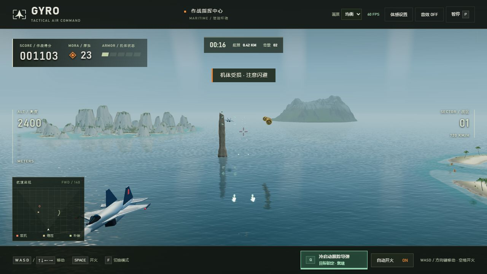

# GYRO · 苍穹突击

使用 F-22A 外观模型与玄女空天战机的第三人称 3D 空战游戏，支持键盘、触屏和 ESP32-C3 + MPU6050 蓝牙 / USB 有线体感。

## 启动

双击 `start-game.cmd` 或桌面「苍穹突击」快捷方式。启动器优先使用支持 Web Bluetooth 的 Edge / Chrome，关闭最后一个游戏网页约 2 秒后，本地服务和启动命令窗口自动退出。刷新页面、暂时切换窗口不会触发退出；有多个游戏标签时，关闭一个仍可继续运行。Ctrl+C 也可停止。

```text
python server.py --open
```

需要 Python 3.10+，不需第三方 Python 包；浏览器需要 WebGL 2。`server.py` 只提供本机静态文件，默认端口 8765，被占用时寻找后续空闲端口。模型、Three.js 和游戏均保存于本地。`--open` 自动启用网页关闭检测；手动托管可用 `--auto-close` 启用。浏览器崩溃或关闭通知未送达时，约 3 分钟未收到页面心跳后自动退出。

## 操作与规则

- WASD / 方向键：移动和升降；触屏提供摇杆。
- 「蓝牙体感」：选择 MPU6050 蓝牙体感，连接设备并设置中位后倾斜移动。
- 空格 / FIRE：按住开火；F 或底部按钮切换自动 / 手动开火。
- Q / 底部「冷启动跟踪导弹」按钮：释放技能，12 秒冷却；触屏可直接点击。
- P / Esc：暂停、继续；切换窗口或打开体感设置时暂停。暂停页可「返回大厅」结束本局并清理战场，保留最高分，再次开始为新一局。
- 金币 +25 分；击毁敌机 +200 分；飞行每秒 +8 分。
- 5 格生命，受伤后短暂无敌；海面礁柱不可击毁，可横向绕开或从顶部越过。
- Su-35 风格敌机采用蓝灰涂装和红色识别标记，需要多次命中，会向玩家射击，击毁后掉落金币。
- 每 25 秒提升战区难度。最佳分数和灵敏度在浏览器本地保存。

## 群岛地图 · Notion Island Maps v2



在大厅选择 **群岛战区**，即可进入一张连续的**全域随机航线**。火山岛、珊瑚环礁、翡翠群岛、月牙湾、悬崖台地、双子峰、喀斯特峰林、雨林河谷和冰川峡湾全部加入随机池，每次出击重新组合。前方地形提示和缩略图随航程更新，无需手动选择区域。首次进入会显示 9 类地形的准备进度，并提前上传纹理；完成后即可出击。

地图来自用户 [Notion 海岛资源页](https://app.notion.com/p/f9b3579d22f940e69843286b6abb1f15) 的 `IslandMaps_v2_Unity.zip`。导入了原始高度图、颜色图、建筑与植被布局、码头、灯塔、高脚屋、小船、岩石、冰山及河湖 / 熔岩网格。Unity 编辑器与运行时脚本未执行；网页实现使用 Three.js。资源全部随项目保存，游玩不需要连接 Notion。

- **统一外观**：同一太阳方向和环境光，低饱和地表、真实木石法线与金属粗糙度，湿润岸线、渐变浅滩和碎浪，配合现有金属战机。河湖法线沿水流方向移动，熔岩使用原资源的发光贴图；船只和冰山轻微浮动。
- **适配空战**：原始 500 米岛屿缩放为游戏场景，同时显示四块不同地形，地形完整离开相机后，才在航线远端随机替换；随机池优先消耗尚未出现的地形，并避开正在显示的四块地形。中央保留飞行通道。航道礁柱在导入模型上细化为六种轮廓，增加断顶、宽底、侵蚀凹槽、岩层与随机朝向，贴图按实际尺寸投射，底部带湿润暗部，仍保持原有碰撞范围；金币、敌机与导弹规则保持一致。岸边宝箱、木桶等是环境装饰。
- **性能分档**：原始高度图 1025² 转换为 257²，运行时按距离 / 画质使用 65²、129² 或 257² 网格。植被按源位置均匀抽样，并按画质限制数量；重复道具实例化，远景和流畅档使用简化模型，小型装饰仅在较近位置显示。使用整岛颜色图而非 Unity 的八层地表混合，以减少纹理采样。九套地形各预建一份，未使用的地形隐藏；飞行中切换已有场景节点，不重新请求资源或生成模型，关闭页面时释放地形资源。
- **海面**：保留多尺度波纹、菲涅耳反射和 GGX 太阳高光；均衡 / 精细档提供 512 / 960 像素上限的实时平面反射，流畅档使用天空反射。此效果为光栅渲染，非硬件光线追踪。地图动画随游戏暂停。

### 资源再生成

运行游戏无需额外依赖。仅重新转换原始包时需要 Python、numpy 和 Pillow：

```powershell
python tools/import_notion_islands.py "<解压后的 IslandMaps_v2_Unity 文件夹>"
```

输出在 `game/dist/assets/notion-islands/`，约 26 MB；入口为 `manifest.json`，记录资源来源及原始 ZIP 的 SHA-256（原包在解压目录旁时）。`dist/notion-islands.js` 负责加载、材质、区域布局和远近细节；`dist/island-map.js` 负责共用海面、光照方向、反射及礁柱接口。

原始资源说明允许用于项目；原始 ZIP 留在本地 `exports/`，不纳入 Git。源树木密度、Unity 碰撞脚本和宝箱交互未直接搬入空战游戏。实际帧率仍取决于显卡和所选画质。

## 蓝牙与 USB 有线体感

接线和固件见 [固件说明](../firmware/README.md)。重新烧录蓝牙版后，开启电脑蓝牙，在游戏里点击「连接蓝牙」，选择 `GYRO-C3-BLE-xxxx`。静置校准后，以舒适握姿设置中位。

每次打开默认蓝牙体感模式；切换到键盘 / 触屏模式会隐藏三轴预览并停止其渲染。中位不跨连接保存。数据停顿 150 ms 时临时冻结飞行，短时恢复后自动继续并保留中位；持续 750 ms 才显示暂停，恢复后手动继续。真正蓝牙断开、传感器异常、重新校准或切换机头朝向后需要重新设置中位。可调整满速倾角、死区、交换轴向和方向反转。

### 蓝牙恢复与稳定性

- 意外断开后，对已授权的同一控制器自动重连；失败时按 1、2、4、8 秒等待，最多尝试 4 次。每次重新发现服务和特征并重新订阅通知，避免复用失效句柄。
- 手动断开、切换 USB / 键盘模式或离开页面会取消待执行重连；后台页面不启动新重连。
- 已连接但姿态通知持续停顿时，尝试重新启用通知并读取一次最新姿态；约 3 秒仍未恢复通知则重新建立连接。恢复操作与命令串行执行，避免 Windows GATT 并发冲突。
- 短暂数据停顿保留中位，150 ms 后仍冻结输入，持续 750 ms 显示暂停；恢复新通知后手动继续。真正重连会清除旧中位，需要静置并设置中位后继续。
- 新连接使用独立命令队列，旧连接异步任务不能覆盖新连接状态或继续读取旧特征。

2026-10-15：上述恢复路径已通过模拟 GATT 回归测试，涵盖通知停滞、失败重试上限、取消操作、单监听器及 USB 模式切换。此次是游戏端恢复改进，兼容当前双模式固件，无需重烧；尚未完成新版的长时真实无线游玩测量。

### USB 有线连接

1. 更新为 USB + BLE 双模式固件，接线保持 VCC→3V3、GND→GND、SDA→4、SCL→5。
2. 用支持数据传输的 Type-C 线连接 ESP32-C3 和电脑。
3. 在体感设置的「操控方式」选择「MPU6050 USB 有线体感」。
4. 点击「连接 USB」，在 Chrome / Edge 串口选择器中选择 ESP32-C3 USB JTAG/serial（本机 COM29）。串口监视器、烧录工具等必须先关闭。
5. 静置到姿态就绪，设置中位后开始；三轴预览、机头操控轴、死区和反向设置与蓝牙共用。

浏览器直接使用 Web Serial，静态服务不代理串口。原生 USB 不依赖蓝牙或无线网络，目标 100 Hz；115200 为串口打开参数，原生 USB 的传输不受 UART 波特率限制。校验错误帧会丢弃并重新同步，每批只采用最新姿态。150 ms / 750 ms 数据保护也适用于 USB。拔线或切换到另一种连接方式会暂停并清除中位；键盘模式关闭预览并保留当前连接，重新切回同一体感模式可继续。

USB 必须更新双模式固件，已有仅 BLE 固件无法应答 USB 握手。USB 断开或页面后台不再发送心跳时，固件约 3 秒后停止有线发送，蓝牙仍可连接。USB 通道专用于二进制姿态帧，运行时文字日志关闭；不要用文本串口监视器读取数据。

2026-10-12 COM29 短时实测：8 秒收到 801 帧，约 100.4 Hz，flags=5，8 次命令应答及停止发送检查通过。双模式固件的 BLE 检查收到 515 帧，约 100.1 Hz。游戏页面也已直接连上 USB，验证中位、重新校准、三轴预览和断开释放串口；页面显示约 100 Hz，命令往返约 3–5 ms。频率不能代替完整动作到画面的延迟测量。

### 实时三轴模型

蓝牙设置内嵌 GY-521 / MPU6050 三维模型，包含蓝色电路板、芯片、安装孔和八针排针。默认显示飞机，切换按钮按「飞机 / 陀螺仪」排序，飞机跟随当前战场显示 F-22A 或玄女，使用与游戏相同的模型；飞机与板卡共享实时姿态与三轴。默认飞机机头朝 +X、左翼朝 +Y、机背朝 +Z。可用「机头朝向 / 操控轴」选择 ±X / ±Y / ±Z 六个方向，本地保存选择；机头朝向同时调整飞机预览和操控坐标：围绕所选机头方向横滚控制左右，围绕飞机左翼方向俯仰控制升降。以设置中位时的完整姿态为参考，用四元数计算相对旋转再转换到飞机坐标；反向和交换轴仍在此基础上生效。切换朝向会暂停并清除旧中位，静置片刻重新设置中位后继续。沿 ±Z 轴时需要 GYB2 的偏航数据；旧 GYB1 固件会提示升级。切换只更换模型，保留当前姿态、视角和蓝牙连接，首次打开预览时加载飞机，后续切换复用模型。无需更新固件。点击「立体 / 俯视」切换视角，连接并静置校准完成后模型跟随传感器转动，不必先设置游戏中位。

- 红色 X：横滚轴，正方向由排针指向安装孔一侧。
- 绿色 Y：俯仰轴，正方向由 INT 指向 VCC 一端。
- 蓝色 Z：偏航轴，正方向垂直芯片面向上。
- 三轴原点为芯片中心；虚线表示负方向，浅色网格保持水平。
- 模型采用传感器原始融合姿态，不应用游戏中位、死区、灵敏度、反向或交换轴设置。
- 偏航仅为相对角度，静止校准建立参考。MPU6050 没有磁力计，长时间会有漂移；机头沿 ±Z 时偏航参与横滚操控，出现偏移时重新设置中位。
- 新固件输出 GYB2，保持 20 字节、目标 100 Hz 通知。旧 GYB1 固件仍可操控，预览只显示横滚 / 俯仰，偏航读数为「—」。升级固件后需要刷新游戏。
- 无连接时显示水平参考模型；校准、故障或数据超过 150 ms 时冻结预览，读数为「—」并提示原因。重新收到有效数据即更新。
- 仅首次打开设置时加载预览；关闭面板或隐藏页面停止预览渲染。

2026-10-12 已在实际游戏页面连上 GYRO-C3-BLE-95BA，观察到约 100 Hz 接收与三轴角度显示，并检查立体 / 俯视切换和页面错误日志。动态手持转动和长时间漂移仍需实际使用确认。

模型源码为 `dist/gyro-model.js`，渲染与实时数据接入为 `dist/gyro-view.js`。元件外形用于辨识方向，非生产级机械 CAD。

### 常见情况

- **请使用支持蓝牙的 Chrome / Edge**：换用 Chrome / Edge，通过本地快捷方式打开，并开启电脑蓝牙。
- **设备列表没有控制器**：确认已烧录新固件、开发板有电，且未被另一个电脑或游戏窗口连接。
- **蓝牙已连接 · 请检查 MPU6050 接线**：断电检查 VCC→3V3、GND→GND、SDA→4、SCL→5。
- **静置校准中**：保持静止，等待约 2–4 秒或更久；之后设置中位。
- **蓝牙已连接 · 等待姿态数据**：重新连接，确认通知已开启，检查供电和接线，或切换 USB 有线模式排查。
- **方向相反**：调整交换轴向 / 方向反转，再设置中位。

测量值显示命令往返、最近一秒通知接收频率和本机数据年龄。它们不代表动作到画面的总延迟。

测试可在仓库根目录运行 `node game/test-ble.mjs` 、`node game/test-game.mjs` 、`node game/test-gyro-model.mjs` 、`node game/test-control-frame.mjs` 与 `node game/test-usb.mjs`。软件测试不能替代真实传感器和蓝牙硬件联调。

模型位于 `dist/assets/airplane-f22.glb`，原素材位于 `../assets/models/`。Three.js 许可证见 `dist/vendor/LICENSE.txt`。

## Su-35 风格敌机

敌方模型为原创程序化游戏美术，参考 [UAC Su-35 官方资料](https://uacrussia.ru/en/aircraft/lineup/military/su-35/) 的外形特征：长机鼻、单座座舱、翼根边条、后掠机翼、双垂尾、双发机身与圆形喷口。比例按游戏画面调整，不是工程模型；未复制第三方网格或纹理。

源码 `dist/enemy-model.js`，约 5,388 个三角面，按 8 种机身材质合并绘制，表面接缝直接使用机身材质，不增加线段绘制。同场敌机共享几何与材质、各自保留独立变换，击毁时只移除实例。新的简化命中范围覆盖较宽机翼和较长机身。

运行游戏服务后打开 `/enemy-preview.html` 可查看前侧、俯视、后侧和自动旋转。预览与游戏使用相同模型。测试：`node game/test-enemy-model.mjs` 与 `node game/test-game.mjs`（含翼尖命中、上方射击未命中和机翼碰撞）。

## 机身蒙皮接缝

F-22 和 Su-35 使用 `dist/airframe-surface.js` 生成的 PBR 表面细节：凹槽高度、轻微蒙皮色差、粗糙度变化和少量沉头紧固件。布局围绕检修口、发动机罩和机翼控制面组织，避免重复方格和贯穿整架机身的黑线。它们为原创游戏美术细节，非真实飞机制造图。

接缝使用曲面 UV 材质，随光照产生浅凹槽明暗；纹理采用 mipmap 和各向异性过滤，远处自然淡化，不再绘制悬浮线段。侧壁、玻璃和喷口不使用顶部投影；F-22 的腹部与垂尾分别使用独立投影方向。F-22 使用 2048² 像素上下表面图集和 512² 像素垂尾图集，Su-35 使用 1024² 像素图集；每种图集包含颜色和高度/粗糙度两张纹理，首次装载时生成。敌机实例共享材质与几何，游戏和蓝牙飞机预览各自拥有纹理并独立释放。游戏与姿态预览共用同一细节生成器。

## 冷启动跟踪导弹技能

每局开始即可使用，按 **Q** 或点击底部「冷启动跟踪导弹」按钮发射。自动选取前方 140 个场景单位内的敌机，优先较近、靠近航线的目标，并显示青色锁定框；成功发射后冷却 **12 秒**，按钮显示倒计时与恢复进度。没有可锁定目标时不消耗技能。技能独立于自动 / 手动机炮，键盘、触屏、蓝牙及 USB 体感均可使用。

导弹先从左右翼下交替弹射，**0.35 秒后点火**，蓝白尾焰出现后加速并沿弧线追踪。会根据敌机移动提前瞄准，原目标已被机炮击毁时重新捕获前方敌机；失去全部目标后沿当前方向飞行，最多存活 5 秒。命中敌机造成 8 点伤害（当前普通敌机可一击击毁），沿用 +200 分与 3 枚摩拉掉落。礁柱、小行星和环框实体会拦截导弹，环框中央可穿过。

群岛和轨道禁区共享技能。冷却、弹射、追踪和尾焰均随有效游戏时间推进，暂停、后台以及体感数据短暂停顿时冻结；重新出击或返回大厅会清理飞弹并重置冷却。技能完全在游戏网页内运行，无需更新 ESP32 固件。玩家导弹使用独立的青色识别环和蓝白尾焰，共享缓存几何与材质；锁定框仅创建一次并复用。

## 敌方飞弹

敌机射击使用 `dist/missile-model.js` 中的原创三维飞弹：灰白金属弹体、深色尖弹头、红色识别环、四片后掠尾翼、前部小翼和双层橙白尾焰。弹体朝向实际速度方向，敌机左右翼下交替发射，发射时瞄准玩家后直线飞行。速度、发射间隔、伤害和命中半径沿用原设置。

尾焰只在游戏运行时脉动，暂停及体感数据中断时随飞弹一起冻结。弹体按顶点色合并为一次绘制，加上两层尾焰，每枚飞弹共三次绘制；各实例共享几何与材质，命中、超时或返回大厅时移除实例。

## 重力滚球迷宫

重力滚球已移至独立目录 [gravity-maze](../gravity-maze/README.md)，使用专属网页、图标、桌面快捷方式及独立控制设置。双击 `../gravity-maze/start-maze.cmd` 启动；本目录旧 `start-maze.cmd` 仍会转交新启动器。

## 战术界面

界面采用炭黑、军灰、警示橙的现代战术风格，包含任务简报、载具识别图、作战报告和统一的体感控制面板。中文使用本机黑体，英文和数字优先使用 Bahnschrift，缺失时自动回退系统字体；所有图形和样式随游戏离线加载。

飞行时显示任务时间、航程、击毁数和前方航道雷达。雷达每秒更新 10 次，显示前方 140 个场景单位内的实际敌机、礁柱和补给；玩家位于下方中央，雷达不显示高度。大厅隐藏战斗仪表，暂停和任务结束显示独立面板。

## 摩拉拾取模型

空战航线补给与击毁敌机掉落改为《原神》摩拉风格金币，由 `dist/coin-model.js` 程序化重建实心币身、圆润厚币边、双面凸起同心边框和三叶交织纹章。浅金浮雕与深金底面使用金属材质，原有旋转、拾取范围、计数和每枚 25 分的奖励保持一致；界面显示为「摩拉」。模型是对外观的手工风格化重建，没有使用提取的官方游戏模型。外观参考：[摩拉图标](https://www.pngaaa.com/detail/5776581)。

所有摩拉实例共享单份几何和材质，每枚只需一次绘制，不加载外部纹理。


标题文字增加金属压印、轻微划痕、橙色热辉与间歇扫光；出击按钮和任务通知使用一次性扫描高光。仪表数字保持静态清晰，系统开启「减少动态效果」时停用字体扫光。效果完全由本地 CSS 生成。

### 摩拉立体层次

币坯采用阶梯式截面，外圈总厚度由约 0.20 增至 0.39 个游戏单位；中央纹章高于凹底约 0.09–0.14，具有独立侧壁与倒角。币边加入 40 道立体齿纹，三个菱形印记改为挤出浮雕。加深凹底与侧壁颜色、降低自发光，使金属高光更容易表现体积；币身略微倾斜后沿用原有旋转动画。所有细节仍合并在同一网格中，并共享几何与材质。

## 轨道禁区 / 双地图

大厅提供「群岛战区 / 轨道禁区」切换，并保存上次选择。新安装默认太空地图；暂停或任务结束后可返回大厅更换战场。共用现有摩拉、得分、射击、键盘/触屏/蓝牙/USB 操控规则与历史最佳战绩。

轨道禁区包含采用本地 NASA Blue Marble 贴图的地球与薄大气辉光、星空、远景空间站、漂浮残骸和 玄女空天战机的双发蓝色尾焰。航道障碍为小行星、卫星残骸与环框：环框中央可以安全穿越，边框有碰撞并阻挡射击。每第三组航线出现一组环框与中央摩拉，敌机与导弹沿用现有系统。两侧及远处的大型残骸和空间站为背景；本版空间站没有炮台。太空采用街机飞行，不模拟轨道力学；高度读数表示航道内相对高度。

太空场景无海面反射渲染开销。暂停及体感数据短暂停顿时，场景与推进器随游戏时间冻结。场景资产和地球贴图均随游戏分发，游玩时无需联网下载或重烧固件。

## 轨道禁区画面精修

- 准星使用白色主线与 `mix-blend-mode: difference` 逐像素反色；准星为 28px 的四段短线，中央留空，取消外围括号和双重亮边；仅保留轻微暗边辅助中灰背景识别。无需逐帧读取 GPU 像素，不增加控制链路采样。
- 地球使用 NASA Blue Marble 的 2048 × 1024 地表和云层贴图（历史合成影像，非实时天气），加入独立缓慢移动的云层、云影、海面反光、昼夜过渡和薄大气边缘；来源见 `dist/assets/earth/ATTRIBUTION.md`。
- 环框采用分段倒角装甲、金属导轨、紧固件和局部指示灯，空间站增加双层环架、桁架、散热部件与太阳能板；原有穿环碰撞尺寸不变。材质使用缓存的本地程序贴图与粗糙度、凹凸细节，静态环框几何按材质合并，控制绘制开销。
- 调低太空环境蓝光，改用冷色反射与暖白主光表现材质。效果使用实时光栅渲染，不是硬件光线追踪。

## 玄女 XUAN NV 空天战机（轨道禁区与模型预览）

双击 `start-spaceplane.cmd` 打开模型，也可在运行游戏服务后访问 `/spaceplane-preview.html`。玄女已作为「轨道禁区」的玩家飞机接入游戏；大厅选择轨道禁区后，载具名称、示意图和三维模型一起切换，群岛战区继续使用 F-22。独立预览仍可打开。

模型源码为 `dist/spaceplane-model.js`，依据[用户指定的商品照片](https://tao.hooos.com/goods_YgY70JjuptXDWwBk2zfW7YT2t6-aAZjjVSda9OoWDgIa.html)重建可见外形：细长机头、抬高翼座与前掠主翼、黑白分层装甲、橙黄翼尖。整体长宽高按厂家标称 34.4 × 22.4 × 5.7 的比例复刻，主翼位于机身上方，翼根支撑、下方间隙与腹部结构分层建模。模型不是官方源模型或工程 CAD；不可见结构及缺少尺寸的局部细节依据照片估算。

预览默认使用较低的前侧视角，显示机身与高置主翼的层次，并使用柔和主光阴影表现翼座遮挡。支持拖动旋转、滚轮缩放、前侧 / 后侧 / 正侧视 / 正前视 / 正俯视 / 尾部特写、自动旋转和尾焰演示开关；正侧视、正前视与正俯视采用正交投影，方便比较高度、厚度和轮廓。尾焰默认关闭，仅作为可选动态演示。参考商品链接随预览页提供。关闭启动器打开的预览页面后，服务按现有生命周期机制退出；模型与材质均在本地生成。

玄女复用现有键盘、触屏、蓝牙及 USB 操控、射击和碰撞规则。游戏使用外层载具节点进行缩放和飞行动画，保留模型内部长宽高比例及高置翼结构；出击后启用原模型双发尾焰，暂停时随游戏时间冻结，返回大厅关闭尾焰。两种飞机只创建一次，切换地图时复用。

体感设置中的飞机姿态预览跟随战场：轨道禁区显示玄女，群岛战区显示 F-22，标题和标识同步切换。两机共用传感器坐标转换、机头朝向及实时三轴姿态；切换仅改变可视模型，不重置连接或中位。MPU6050 板卡预览仍可独立选择。模型按需创建并缓存，过期的异步加载不会覆盖当前选择。

### 蓝牙接收延迟读数

设置中新增「蓝牙接收延迟（估算）」，按最新有效姿态的设备采样时间与浏览器接收时间计算范围，单位 ms。命令应答产生的设备时钟锚点对应浏览器发送到收到应答的整个区间，使用该区间而非假设 RTT/2，并预留 1 ms 时钟余量。此项包含采样到蓝牙通知、传输和浏览器回调调度，不能视为纯无线延迟或动作到画面的总延迟。

数值在收到新姿态时更新，不随「数据年龄」增长；时钟探测尚未完成、时钟锚点超过 2 秒、姿态过期、连接断开或使用 USB 时显示「—」。原有命令往返、接收频率和数据年龄继续显示。无需更新固件。

### 同时用串口与蓝牙测量接收时间差

`tools/measure_ble_delay.py` 会同时连接 ESP32-C3 的 USB 与 BLE，使用同一电脑的 `perf_counter_ns()` 标记收到数据的时刻。只配对序号、设备采样时钟及完整 GYB2 负载均一致的有效帧，不用插值或相邻采样代替同一采样。

先关闭游戏中的蓝牙连接与串口监视器，用 Type-C 数据线连接开发板。Python 需安装 `bleak` 与 `pyserial`：

```text
python tools/measure_ble_delay.py --port COM29 --name GYRO-C3-BLE-95BA --seconds 30
```

结果保存为 `game/.runtime/ble-usb-delay.json`，包含配对数量、每帧时间差、中位数、P95 和最小/最大值。数值为 **BLE 接收时间 − USB 接收时间**，保留负值；USB 自身延迟及 Windows 驱动/回调调度仍会影响结果，因此不能把它当作 BLE 的绝对单向延迟或游戏画面总延迟。工具在结束时停止有线发送并释放串口与蓝牙连接。`--deps` 可指定独立依赖目录，`--output` 可指定报告路径。

2026-10-15 实测（COM29 + GYRO-C3-BLE-95BA，30 秒）：USB 收到 3021 份有效采样，BLE 收到 3009 份，其中 103 份序号、设备采样时钟和负载完全一致。对这 103 对计算 BLE−USB 接收时间差：中位数 10.826 ms、P95 16.497 ms、最小 5.455 ms、最大 26.132 ms。两条通道各自以约 100 Hz 发送，并不保证取到相同的 200 Hz 采样，统计仅涵盖实际匹配帧。此数据为相对 USB 的实测差值，不是 BLE 绝对单向或游戏画面总延迟。Windows 按服务 UUID 筛选发现时曾报设备不识别命令，测量工具改用完整 GATT 服务发现后成功完成测量。

## 敌机摧毁动画

机炮或跟踪导弹击毁敌机时，触发约 1.9 秒的分层爆炸：短促暖白闪光、多个扩散火团、细冲击光环、放射火花、翻滚金属碎片和逐渐消散的烟尘。群岛中碎片下落、烟雾上升，轨道中向外漂散。动画随航道前进，仅由游戏时间驱动，暂停及体感数据等待时冻结；重开或返回大厅清空。按画质最多同时显示 2 / 4 / 6 组爆炸，六组资源预先分配并循环复用，结束后回收到池中，关闭页面时统一释放。流畅档减少烟火层数与碎片数量。爆炸仅作视觉表现。

## F-22A 外形与渲染重建

海岛玩家飞机依据 [USAF F-22 公开资料](https://www.af.mil/About-Us/Fact-Sheets/Display/Article/104506/f-22-raptor/) 和 [Lockheed Martin F-22 产品卡](https://www.lockheedmartin.com/content/dam/lockheed-martin/aero/documents/f22/FG19-Product%20Card%20F-22.pdf) 的照片与轮廓重建。长、翼展参照 18.9 m、13.56 m；局部曲面及检修盖为照片外观近似，不是制造 CAD。

- 几何重建扁菱形前机身、翼身融合肩部、双发动机背部隆起、渐薄主翼与平尾、外倾双垂尾；进气道有唇口和内部深度，双矩形二维尾喷口包含层叠瓣片。金色座舱单独使用光滑反射材质。
- 灰色涂层采用低对比迷彩、细检修缝、粗糙度分区；腹部闭合舱门、垂尾标记各有独立纹理方向。纹理本地生成，远处通过 mipmap 淡化细节。
- 同材质部件在载入时合批；均衡 / 精细画质为玩家飞机开启一张跟随机身的 512² 局部阴影，并按 20 / 30 Hz 更新；流畅档关闭实时阴影。姿态面板使用 512² 阴影，按可见性启停，渲染上限 30 FPS。
- 海岛大厅、实战与设置中的 F-22 姿态预览共用新版 GLB。源建模脚本、GLB、OBJ/MTL 和独立预览保存于 `tools/build_airplane.py` 与 `assets/models/`。

## 卡顿与慢动作修复

游戏改为按实际帧间隔推进，拆成不超过 1/60 秒的碰撞子步。旧版每帧截断为 33 ms，低于约 30 FPS 会丢失时间：20 FPS 下，现实 10 秒只推进游戏 6.6 秒。现在 10–165 FPS 的软件时间一致性检查均为 10 秒；单次超过 250 ms 的停顿限制追赶量，避免恢复时穿透。暂停、后台与体感数据保护继续冻结游戏，不补跑停顿期间的战斗。

启动时会显示「正在准备战场」，准备当前地图、战斗与爆炸的常用材质；切换地图时在大厅准备相应光照变体。地球贴图在入场前等待加载完成或采用 fallback。战斗粒子改为上限 384 个的预分配实例池，统一一次绘制，避免逐粒创建和销毁 Mesh/Material。实时反射与阴影由画质档控制，仪表最多 10 Hz，导弹锁定框继续跟随每个画面帧更新。

持续低帧率时自动逐步降低渲染分辨率，稳定恢复后缓慢提高清晰度。飞机几何、材质纹理、碰撞和控制采样精度不变。暂停、后台和体感数据停顿不触发降质；连续超过 250 ms 的极低帧率也能触发快速降质。

检查与测量说明见 [性能排查记录](PERFORMANCE.md)。回归检查：`node game/test-performance.mjs`、`node game/test-game.mjs`；另已运行蓝牙、USB、操控轴和接收延迟测试。软件/独立浏览器采样不替代长时间手持实机游玩。

## 按战场区分射击效果

| 战场 | 普通射击 | 炮口效果 |
| --- | --- | --- |
| 群岛战区 / F-22 | 黄白亮芯、橙红短尾迹的火光弹 | 约 75 ms 的五瓣开火闪焰 |
| 轨道禁区 / 玄女 | 原有青绿色激光弹 | 不显示机炮火焰 |

海岛的炮口闪焰跟随飞机位置、横滚与俯仰，炮弹从同一炮口位置发出，配合短促机炮声；太空恢复原有激光射击声。选择地图时自动切换武器表现，并清除上一地图的残留闪焰。

自动 / 手动开火、键盘 / 触屏 / 蓝牙 / USB 均按上述地图规则使用。暂停和体感数据停顿时效果冻结，重新出击或返回大厅清理闪焰。炮弹速度、伤害、射速与跟踪导弹玩法保持现有设置。

实现位于 `dist/cannon-effects.js`：火光弹与闪焰共用程序材质，激光弹单独缓存几何与材质，两个炮口网格常驻复用。两套材质均纳入战场预热流程，无需更新固件。

## 流畅画质与 FPS 显示（2026-10-16）

右上角新增「画质」与实际画面 FPS。首次默认为「流畅」，选择会在本机保存：

| 画质 | 游玩帧率上限 | 三维像素预算 | 实时反射 / 阴影 | 同时爆炸 |
| --- | ---: | ---: | --- | ---: |
| 流畅（默认） | 60 FPS | 1600 × 900 | 关闭，保留天空反射和金属材质 | 2 组，减少烟火层数 |
| 均衡 | 60 FPS | 1920 × 1080 | 512 像素反射 15 Hz / 阴影 20 Hz | 4 组 |
| 精细 | 120 FPS | 2880 × 1620 | 960 像素反射 30 Hz / 阴影 30 Hz | 6 组 |

上述为预算上限，按窗口尺寸、DPI 及实际负载自适应；不会拉大低分辨率窗口。大厅、暂停、结束与姿态预览最高 30 FPS，后台停止主场景绘制；大厅明显低于 30 FPS 时也会降低三维分辨率，正常的 30 FPS 限制不会误触降质。逻辑继续按真实时间推进并分步碰撞，传感器接收链路、伤害和技能冷却规则不变。

普通机炮和激光弹改为实例化批量绘制，每种类型一次绘制；六组爆炸网格、材质及动态缓冲循环复用。静态海岛建筑和背景卫星按材质合并，减少驱动调用。原有海岛火光弹与炮口闪焰、太空激光弹继续按地图区分。

为减少 GPU 同步查询，生产默认关闭着色器日志检查；开发排错可在 URL 增加 `?debug-gpu`。FPS 旁的提示包含实际三维绘制尺寸；若检测到软件渲染，也会提示硬件加速状态。FPS 仅表示画面绘制频率，不代表蓝牙频率或动作延迟。

本机独立浏览器最后一轮普通 / 爆炸压力采样均约 60 FPS，详见 [性能排查记录](PERFORMANCE.md)。本轮进行了语法检查及运行时性能采样，没有新增或运行自动化回归测试。
